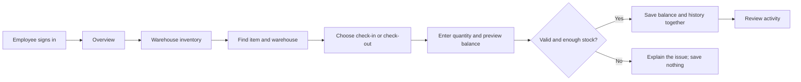

# BlueBox Warehouse Inventory Manager

A browser-based internal inventory management project for a fictional movie and game rental business. BlueBox lets employees track warehouse quantities, record stock movements, and review who changed inventory and when.

**Status: Milestone 2 implementation in review.** Manager administration, linked corrections (including corrections of corrections), zero-stock retirement, OMDb lookup, and the overview dashboard extend the working inventory system. Milestone 1 passed GitHub's disposable SQL Server checks. Milestone 2 SQL Server checks and the Windows/teacher-database walkthrough must be verified before final sign-off.

## Project at a glance

| Area | Plan |
| --- | --- |
| Purpose | Class project and portfolio demonstration |
| Interface | Browser-based internal employee website |
| Application | C# / .NET 10 with ASP.NET Core Razor Pages |
| Database | Microsoft SQL Server, managed through SQL Server Management Studio (SSMS) |
| Data access | ADO.NET (`SqlConnection`, `SqlCommand`, `DataTable`), based on the instructor’s template |
| External integration | OMDb for optional movie posters and age classifications |
| Inventory model | Quantities per catalog item and warehouse location |
| Users | Staff and managers |

## Milestone 1 capabilities

- Employee sign-in with staff and manager permissions.
- A searchable movie and game catalog, with separate entries for different formats.
- Inventory quantities across warehouse locations.
- Check-in and check-out with a preview of the resulting balance.
- Protection against negative inventory and conflicting stock updates.
- Permanent movement history identifying the item, warehouse, employee, quantity, and time.
- Private demo-data seeding and first-manager setup commands.

## Milestone 2 capabilities

- Manager screens for catalog items, employee accounts, and warehouses.
- Last-active-manager protection, including competing account changes.
- Full opposite-movement corrections with explanations and permanent links; a correction can itself be corrected once.
- Zero-stock checks before item archival or warehouse deactivation.
- Server-side OMDb search and movie selection, optional posters/age ratings, and manual fallback.
- Overview totals, stock by warehouse, recent activity, and labeled Central time.

The [roadmap](docs/roadmap.md) distinguishes implementation from final verification. See the [Milestone 2 review guide](docs/milestone-2.md) for decisions and review steps.

**Scope:** warehouse stock only. Customer rentals, payments, late fees, streaming, and kiosk inventory are outside the initial project.

## Employee workflow



Check-in means adding units to a warehouse; check-out means removing units from it. These are warehouse movements, not customer rental transactions.

## Documentation

| Document | Contents |
| --- | --- |
| [Development and Windows setup](docs/development.md) | SDK, private connection configuration, demo data, running, and tests |
| [Project plan](docs/project-plan.md) | Agreed scope, screens, workflows, and decisions |
| [Requirements](docs/requirements.md) | Permissions, business rules, and acceptance criteria |
| [Architecture and database](docs/architecture-and-database.md) | Proposed application structure, entities, relationships, and schema adjustments |
| [Roadmap](docs/roadmap.md) | Build sequence and completion criteria |
| [Demo guide](docs/demo-guide.md) | Planned fake data and a portfolio presentation walkthrough |
| [SQL Server scripts](database/README.md) | Existing-table schema update and SSMS instructions |
| [Instructor template adaptation](docs/instructor-template.md) | Required structure, corrections, and review findings |
| [Runtime SQL query catalog](docs/sql-query-catalog.md) | Application SELECT/INSERT/UPDATE statements |

Download the [Word version of the project plan](docs/BlueBox-Project-Plan.docx) for sharing or class submission. The Markdown plan is the maintained source; regenerate the Word copy when the baseline changes.

The supplied warehouse conceptual model, database design, data dictionary, and screen mockups informed this plan. [Source notes](docs/project-plan.md#planning-sources) explain how they relate to the original assignment brief. The original attachments are not bundled here.

## Running the project

Install the SDK pinned in `global.json`, prepare the SQL Server tables, and configure `ConnectionStrings:BlueBox` privately. Follow the [development guide](docs/development.md) for Visual Studio setup and initial accounts, then run:

```sh
dotnet restore BlueBox.sln --locked-mode
dotnet build BlueBox.sln --no-restore
dotnet run --project src/BlueBox.Web
```

Open `BlueBox.sln` in a Visual Studio release supporting .NET 10 on Windows, or use VS Code/the CLI on Mac. No database is created, altered, or seeded automatically when the website starts. The teacher's database has not been accessed or changed from this workspace.

The connection string belongs in user secrets or an environment variable. Never commit credentials, real employee data, or API keys. Configure `Omdb:ApiKey` privately to enable movie lookup; manual entry works without a key.

## Validation

```sh
dotnet test BlueBox.sln --configuration Release
```

The default suite runs unit/routing checks and explicitly skips database integration checks when no test instance is configured. SQL Server mode applies the supplied current schema to generated disposable databases and runs the real HTTP/stock workflow. GitHub Actions runs both paths for feature-branch pushes, pull requests, and main. See [test setup and limits](docs/development.md#automated-checks).

The Windows walkthrough against the teacher's SQL Server remains required before calling the milestone complete. Do not use the shared teacher server for automated tests that create/drop test databases.

## Portfolio focus

The project demonstrates relational database design, employee authentication, role policy, transactional stock updates, and audit history in C#. It also includes server-side external API integration, manager administration, and linked audit corrections. Screenshots and a public demo link will be added after final validation and deployment.
