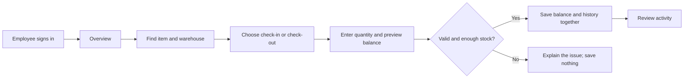

# BlueBox Warehouse Inventory Manager

A planned internal inventory management website for a fictional movie and game rental business. BlueBox will let employees track warehouse quantities, record stock movements, and review who changed inventory and when.

**Status: planning complete for the initial scope; application implementation has not started.** This repository currently contains project documentation. Features, architecture, and demo scenarios below describe the intended system, not working functionality.

## Project at a glance

| Area | Plan |
| --- | --- |
| Purpose | Class project and portfolio demonstration |
| Interface | Browser-based internal employee website |
| Application | C# with ASP.NET Core Razor Pages |
| Database | Microsoft SQL Server, managed through SQL Server Management Studio (SSMS) |
| External integration | OMDb for movie posters and age classifications |
| Inventory model | Quantities per catalog item and warehouse location |
| Users | Staff and managers |

## Planned capabilities

- Employee sign-in with staff and manager permissions.
- A searchable movie and game catalog, with separate entries for different formats.
- Inventory quantities across warehouse locations.
- Check-in and check-out with a preview of the resulting balance.
- Protection against negative inventory and conflicting stock updates.
- Permanent movement history identifying the item, warehouse, employee, quantity, and time.
- Manager-only corrections linked to the original movement.
- Manager administration for items, employee accounts, and warehouse locations.
- An overview dashboard with stock totals and recent activity.

**Scope:** warehouse stock only. Customer rentals, payments, late fees, streaming, and kiosk inventory are outside the initial project.

## Planned employee workflow

Check-in means adding units to a warehouse; check-out means removing units from it. These are warehouse movements, not customer rental transactions.

## Documentation

| Document | Contents |
| --- | --- |
| [Project plan](docs/project-plan.md) | Agreed scope, screens, workflows, and decisions |
| [Requirements](docs/requirements.md) | Permissions, business rules, and acceptance criteria |
| [Architecture and database](docs/architecture-and-database.md) | Proposed application structure, entities, relationships, and schema adjustments |
| [Roadmap](docs/roadmap.md) | Build sequence and completion criteria |
| [Demo guide](docs/demo-guide.md) | Planned fake data and a portfolio presentation walkthrough |

Download the [Word version of the project plan](docs/BlueBox-Project-Plan.docx) for sharing or class submission. The Markdown plan is the maintained source; regenerate the Word copy when the baseline changes.

The supplied warehouse conceptual model, database design, data dictionary, and screen mockups informed this plan. [Source notes](docs/project-plan.md#planning-sources) explain how they relate to the original assignment brief. The original attachments are not bundled here.

## Running the project

There is no runnable application, project file, dependency installation, or test suite in this repository yet. Setup commands will be documented when implementation establishes the .NET version and SQL Server connection requirements.

Existing SQL table definitions were supplied and reviewed during planning; database connectivity and deployed schema have not been verified from this repository. Planned schema adjustments have not been applied here.

When implemented, the SQL Server connection string and OMDb API key will be configured outside source control. Never commit credentials, real employee data, or API keys. Fake records will be used for the demo.

## Portfolio focus

The intended project demonstrates relational database design, role-based access, reliable inventory transactions, audit history, and external API integration in C#. Screenshots, verified setup instructions, and test results will be added as those capabilities are built and validated.
