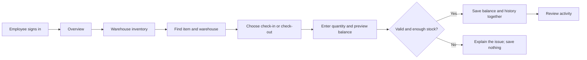

# BlueBox Warehouse Inventory Manager

A browser-based internal inventory management project for a fictional movie and game rental business. BlueBox lets employees track warehouse quantities, record stock movements, and review who changed inventory and when.

**Status: both milestones’ planned application features are implemented and reviewed.** The reviewed code at `6b37024` passed unit/routing and disposable SQL Server checks in [GitHub Actions](https://github.com/Smoofers-21/IMS-Bluebox/actions/runs/44142192232). Windows testing against the teacher’s database, a live OMDb check, and final screenshots remain before class/demo sign-off. See the [validation record](docs/validation.md) for the tested scope and remaining work.

## Project at a glance

| Area | Implementation |
| --- | --- |
| Purpose | Class project and portfolio demonstration |
| Interface | Browser-based internal employee website |
| Application | C# / .NET 10 with ASP.NET Core Razor Pages |
| Database | Microsoft SQL Server, managed through SQL Server Management Studio (SSMS) |
| Data access | ADO.NET (`SqlConnection`, `SqlCommand`, `DataTable`), based on the instructor’s template |
| External integration | OMDb for optional movie posters and age classifications |
| Inventory model | Quantities per catalog item and warehouse location |
| Users | Staff and managers |

## Milestone 1 capabilities

- Employee sign-in with staff and manager permissions.
- A searchable movie and game catalog, with separate entries for different formats.
- Inventory quantities across warehouse locations.
- Check-in and check-out with a preview of the resulting balance.
- Protection against negative inventory and conflicting stock updates.
- Permanent movement history identifying the item, warehouse, employee, quantity, and time.
- Private demo-data seeding and first-manager setup commands.

## Milestone 2 capabilities

- Manager screens for catalog items, employee accounts, and warehouses.
- Last-active-manager protection, including competing account changes.
- Full opposite-movement corrections with explanations and permanent links; a correction can itself be corrected once.
- Zero-stock checks before item archival or warehouse deactivation.
- Server-side OMDb search and movie selection, optional posters/age ratings, and manual fallback.
- Overview totals, stock by warehouse, recent activity, and labeled Central time.

The [roadmap](docs/roadmap.md) distinguishes implemented features from final verification. The [Milestone 2 review guide](docs/milestone-2.md) describes manager workflows and correction rules.

**Scope:** warehouse stock only. Customer rentals, payments, late fees, streaming, and kiosk inventory are outside the initial project.

## Employee workflow



Check-in means adding units to a warehouse; check-out means removing units from it. These are warehouse movements, not customer rental transactions.

## Documentation

| Document | Contents |
| --- | --- |
| [Development and Windows setup](docs/development.md) | SDK, private connection configuration, demo data, running, and tests |
| [Project plan](docs/project-plan.md) | Agreed scope, screens, workflows, and decisions |
| [Requirements](docs/requirements.md) | Permissions, business rules, and acceptance criteria |
| [Architecture and database](docs/architecture-and-database.md) | Implemented application structure, entities, relationships, and schema alignment |
| [Roadmap](docs/roadmap.md) | Build sequence and completion criteria |
| [Demo guide](docs/demo-guide.md) | Fake demonstration data, presentation walkthrough, and screenshot plan |
| [SQL Server scripts](database/README.md) | When no migration is needed, older-baseline upgrades, and fresh-database setup |
| [Instructor template adaptation](docs/instructor-template.md) | Required structure, corrections, and review findings |
| [Runtime SQL query catalog](docs/sql-query-catalog.md) | All 41 runtime SQL batches, with source links |
| [Milestone 2 review](docs/milestone-2.md) | Manager administration, correction chains, retirement, and review fixes |
| [Validation record](docs/validation.md) | Verified build/test results, CI links, and checks still pending |
| [Class submission and `.slnx`](docs/submission.md) | Pulling the merged code, converting the solution, and packaging source files |

Download the [Word version of the project plan](docs/BlueBox-Project-Plan.docx) for sharing or class submission. The Word copy is synchronized with the maintained Markdown plan; update both when project decisions change.

The supplied warehouse conceptual model, database design, data dictionary, and screen mockups informed this plan. [Source notes](docs/project-plan.md#planning-sources) explain how they relate to the original assignment brief. The original attachments are not bundled here.

## Running the project

Install the SDK pinned in `global.json`, prepare the SQL Server tables, and configure `ConnectionStrings:BlueBox` privately. Follow the [development guide](docs/development.md) for Visual Studio setup and initial accounts, then run:

```sh
dotnet restore BlueBox.sln --locked-mode
dotnet build BlueBox.sln --no-restore
dotnet run --project src/BlueBox.Web
```

Open `BlueBox.sln` in a Visual Studio release supporting .NET 10 on Windows, or use VS Code/the CLI on Mac. No database is created, altered, or seeded automatically when the website starts. The teacher's database has not been accessed or changed from this workspace.

The connection string belongs in user secrets or an environment variable. Never commit credentials, real employee data, or API keys. Configure `Omdb:ApiKey` privately to enable movie lookup; manual entry works without a key.

## Validation

```sh
dotnet test BlueBox.sln --configuration Release
```

The reviewed local suite passed 25 tests and explicitly skipped 26 SQL Server test groups without a configured disposable instance. Those skipped groups are executed by the SQL Server CI job; they are not claimed as local SQL passes. SQL Server mode applies the supplied current schema to generated disposable databases and runs the real HTTP/stock workflow. GitHub Actions runs both paths for feature-branch pushes, pull requests, and main. See [test setup and limits](docs/development.md#automated-checks).

The [verified Milestone 2 run](https://github.com/Smoofers-21/IMS-Bluebox/actions/runs/44142192232) passed both jobs. The workflow cancels older or duplicate branch/PR runs; a canceled duplicate is superseded by the successful run for the same/latest commit. The Windows walkthrough against the teacher's SQL Server remains required before final class sign-off. Do not use the shared teacher server for automated tests that create/drop test databases.

## Class submission

The repository and CI use `BlueBox.sln`. If the instructor requests `.slnx`, first pull the merged `main`, then run `dotnet sln BlueBox.sln migrate` and build `BlueBox.slnx`. Submit the solution with its project folders and required build/database files, following the [submission guide](docs/submission.md). The solution file alone does not contain the application code.

## Portfolio focus

The project demonstrates relational database design, employee authentication, role policy, transactional stock updates, and audit history in C#. It also includes server-side external API integration, manager administration, and linked audit corrections. Screenshots and a public demo link will be added after final validation and deployment.

Public hosting is planned after grading, using a separate database with fake data. GitHub hosts the source; the C# website must run on an application host to be available as a live demo.
