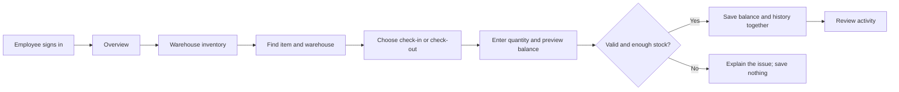

# BlueBox Warehouse Inventory Manager

A web-based warehouse inventory portfolio project for a fictional movie and game business. BlueBox lets employees track quantities across warehouses, record stock movements, and review who changed inventory and when. It demonstrates systems analysis, workflow design, relational data modeling, role-based access, and transactional data integrity.

**Application features: implemented. Deployment: deployed.** BlueBox uses Azure SQL Database and an existing Azure App Service website. The schema, performance indexes, app settings, and firewall setup have been reported complete; the website is deployed, and the live browser walkthrough remains to be verified.

## Website demo — deployed

**[Open BlueBox on Azure](https://bluebox-ims-portfolio-hkc4ckdjhtd5a2gk.westus3-01.azurewebsites.net)**

This is the portfolio website address; the application is deployed, and live verification is pending. Visitors will use the published application in their browser with the public staff account below. The new login-page demo panel appears after this application update is deployed and its Azure display settings are added; screenshots will follow live verification.

The planned demo uses Azure App Service **F1 Free** and the **Azure SQL free offer**, subject to confirming the subscription settings. Free-tier idle shutdown, database resume, and usage limits can delay or temporarily interrupt access. GitHub hosts the source code; Azure runs the website and database.

## Try the demo

**[Open the demo sign-in page](https://bluebox-ims-portfolio-hkc4ckdjhtd5a2gk.westus3-01.azurewebsites.net/Account/Login)**

| Field | Public demo value |
| --- | --- |
| Username | `avery.chen` |
| Password | `DEMO.PASS123321` |

1. Open the sign-in page and select **Try the demo** to expand the credentials, or copy them from the table above.
2. Use **Copy** beside the username, paste it into the normal Username field, then copy/paste the password into Password.
3. Select **Sign in**. If clipboard access is unavailable, select and copy the visible credentials manually; the panel and normal sign-in also work without JavaScript.

This is a **shared interactive demo with fictional data**. STAFF access allows the dashboard, catalog, inventory, movement history, and stock check-in/out. Changes are saved and visible to other visitors. Catalog/account/warehouse administration and transaction corrections remain restricted to managers. Stock submissions are limited to 20 per minute per client IP; application requests are limited to 300 per minute per IP on each instance. A 429 response asks you to wait a minute. These controls reduce bursts but do not guarantee free-tier availability.

The sign-in page is the current source for credentials if the README has not yet caught up with a password change. The owner enables the panel using the two [Azure display settings](docs/azure-portfolio-setup.md#public-demo-display-settings); it is hidden when either setting is empty.

These staff credentials are intentionally public. The owner has configured this account separately; the application still verifies its password, active status, and current database role through the ordinary sign-in flow. Manager passwords, SQL credentials, publish profiles, and API keys remain private. No public registration or automatic demo login is provided.

## Project at a glance

| Area | Implementation |
| --- | --- |
| Purpose | Systems analysis and application development portfolio |
| Interface | Browser-based employee website |
| Application | C# / .NET 10 with ASP.NET Core Razor Pages |
| Hosting | Azure App Service F1 Free; deployed |
| Database | Azure SQL Database with a five-table SQL Server-compatible schema |
| Data access | Parameterized ADO.NET (`SqlConnection`, `SqlCommand`, `DataTable`) |
| External integration | OMDb for optional movie posters and age classifications |
| Inventory model | Quantities per catalog item and warehouse location |
| Users | Staff and managers |

## Inventory workflows

- Employee sign-in with staff and manager permissions, secure cookies, and limits on login attempts, stock submissions, and repeated page requests.
- Searchable movie/game catalog, including separate entries for different formats. Type/format are fixed after the first movement to preserve edition history.
- Warehouse quantities, with 100-row Catalog, Inventory, and Manage Catalog pages that preserve filters. Inventory shows only positive stock for both All locations and a selected warehouse; catalog item details still show zero-stock warehouses.
- Check-in and check-out with a preview of the resulting balance.
- Protection against negative inventory and conflicting stock updates.
- Permanent movement history identifying the item, warehouse, employee, quantity, and time.
- Private account initialization and an explicit first-manager setup command.

## Manager tools and reporting

- Manager screens for catalog items, employee accounts, and warehouses.
- Last-active-manager protection and session revocation after password/username changes.
- Full opposite-movement corrections with explanations and permanent links; a correction can itself be corrected once.
- Zero-stock checks before item archival or warehouse deactivation.
- Server-side OMDb search and movie selection, optional posters/age ratings, and manual fallback.
- Overview totals, stock by warehouse, recent activity, and labeled Central time (or an explicit UTC fallback).

The [manager workflow guide](docs/milestone-2.md) describes administration, correction chains, and retirement rules. Public release still requires the Azure sign-in and workflow checks described in the [deployment guide](docs/github-actions-deployment.md).

**Scope:** warehouse stock only. Customer rentals, payments, late fees, streaming, and kiosk inventory are outside the project.

## Employee workflow



Check-in adds units to a warehouse; check-out removes units from it. These are warehouse movements, not customer rental transactions.

## Documentation

| Document | Contents |
| --- | --- |
| [Azure portfolio setup](docs/azure-portfolio-setup.md) | Free tiers, browser database setup, private settings, firewall rules, and launch checks |
| [GitHub Actions deployment](docs/github-actions-deployment.md) | Manual deployment from main to the existing Azure app, with no local .NET 10 installation |
| [Development setup](docs/development.md) | SDK, private connection configuration, running, and tests |
| [Requirements](docs/requirements.md) | Permissions, business rules, and acceptance criteria |
| [Architecture and database](docs/architecture-and-database.md) | Application structure, entities, relationships, and schema alignment |
| [Database setup and scripts](database/README.md) | Azure SQL installation, indexes, starter data, and disposable test databases |
| [Demo guide](docs/demo-guide.md) | Fictional demonstration data, workflow walkthrough, and screenshots |
| [Runtime SQL query catalog](docs/sql-query-catalog.md) | Runtime SQL batches, with source links |
| [Manager workflow review](docs/milestone-2.md) | Administration, correction chains, retirement, and review fixes |
| [PR #7 Azure review](docs/pr7-review-resolution.md) | Portfolio indexes, proxy configuration, connection-open retry, and deployment checks |
| [PR #9 deployment review](docs/pr9-review-resolution.md) | Environment-scoped credentials, pinned deploy action, and post-upload startup check |
| [PR #11 demo review](docs/pr11-review-resolution.md) | Request limits, optional demo display settings, and verification |
| [Validation record](docs/validation.md) | Versioned build/test results, CI links, and pending live checks |

Planning and review documents record the project's design and implementation history. The setup instructions in this README and the [database README](database/README.md) describe the current Azure portfolio configuration.

## Deploying the website

Follow the [Azure process](docs/azure-portfolio-setup.md) and [GitHub Actions deployment guide](docs/github-actions-deployment.md). Keep the app's Name as the `AZURE_WEBAPP_NAME` repository variable. Store `AZURE_WEBAPP_PUBLISH_PROFILE` on the **azure-portfolio environment**, restrict that environment to the exact **main branch**, and remove any repository-level copy of the credential.

After main's build/SQL checks pass, select **Actions → Deploy BlueBox to Azure → Run workflow → main**. GitHub builds with the pinned SDK, publishes to the existing F1 website, and checks the BlueBox sign-in page. A local .NET 10 installation is not needed for this path. A manual login still verifies Azure SQL connectivity.

Publishing creates no tables, accounts, items, stock, or history. The intended starter data is **one active manager, four active staff, and warehouses in Fayetteville, AR and Bentonville, AR**, initialized through the separately supplied private SQL file if it has not already been run. Items, current inventory, and transactions start empty and will be added through the application. Do not run `--seed-demo` for that setup: it also creates catalog entries and opening stock.

Database connection settings and the OMDb key remain private in Azure. Connection opening has bounded retries for Azure resume/throttling; SQL commands are not automatically replayed.

**README-only changes do not require republishing or restarting the Azure application.** They take effect on GitHub when merged. Deployment is a separate manual action for the initial launch and subsequent application releases.

## Local development

Install the SDK pinned in `global.json`, prepare a development database matching the Azure schema, and configure `ConnectionStrings:BlueBox` privately. Then run:

```sh
dotnet restore BlueBox.sln --locked-mode
dotnet build BlueBox.sln --no-restore
dotnet run --project src/BlueBox.Web
```

Open `BlueBox.sln` in a Visual Studio release supporting .NET 10 on Windows, or use VS Code/the CLI on Mac. No database is created, altered, or seeded automatically when the website starts.

Connection strings belong in user secrets or environment variables. Keep manager/deployment/database credentials, real employee data, and API keys outside source control; only the public staff demo login above is intentionally published. Configure `Omdb:ApiKey` privately to enable movie lookup; manual entry works without a key.

## Validation

Run both the web application and SQL Server integration checks locally with Docker and the pinned SDK:

```sh
bash scripts/test-local.sh
```

This uses a disposable local SQL Server container and cleans it up after the run. It never uses the Azure portfolio connection. UI changes also receive browser checks.

For unit/routing/provider checks alone:

```sh
dotnet test BlueBox.sln --configuration Release
```

The default suite runs local unit/routing/provider checks and skips SQL Server groups when no disposable test instance is configured. SQL Server CI applies the schema to generated disposable SQL Server 2022 databases and runs real HTTP/stock/concurrency tests. Automated create/drop tests never target the Azure portfolio database.

The merged baseline at `cb72cd6` passed [main CI run 44866843871](https://github.com/Smoofers-21/IMS-Bluebox/actions/runs/44866843871): both jobs succeeded, with **105 tests passed, 0 failures** in the SQL-enabled suite (unit tests plus expanded SQL cases). Check the completed run for the current revision in [GitHub Actions](https://github.com/Smoofers-21/IMS-Bluebox/actions/workflows/build.yml) before merging changes.

Public launch requires manual verification of Azure sign-in, stock workflows, OMDb, and free-tier idle resume. The deployment check confirms the sign-in page renders; that anonymous page does not query the database.

## Portfolio focus

BlueBox demonstrates requirements analysis, workflow design, relational database modeling, employee authentication, role policy, transactional stock updates, and audit history. It also includes server-side external API integration, manager administration, and linked audit corrections.

The application uses Azure SQL Database with fictional records and is presented as an independent portfolio project. GitHub hosts the source, documentation, test evidence, and manual deployment workflow. Verified demo access and screenshots will follow launch checks.
