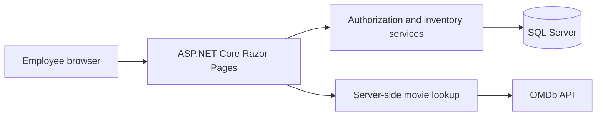
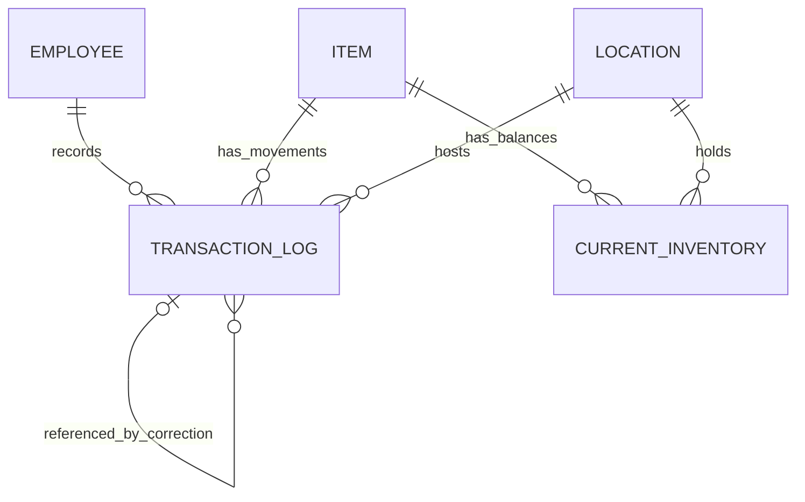

# Architecture and database design

**Status:** Milestones 1 and 2 use this structure for inventory, manager tools, linked corrections, and optional movie metadata. Disposable SQL Server verification passed for the supplied schema; the actual teacher-server connection and Windows walkthrough remain pending. See the [validation record](validation.md). Current implementation and test instructions are in the [development guide](development.md).

## Application structure

Use one ASP.NET Core Razor Pages application. Keep page handling, business rules, and database operations separated enough to test inventory behavior, without introducing microservices or a separate frontend application.

The browser never needs the SQL Server connection string or OMDb key. The database must remain usable when OMDb is unavailable because movie metadata is optional.

The implementation uses .NET 10, ADO.NET through `Microsoft.Data.SqlClient`, cookie authentication, and ASP.NET Core `PasswordHasher<Employee>`. It maps to the five existing business tables without introducing Identity tables. The SDK is pinned in `global.json`. Deployment remains a later decision.

## Core entities

| Entity | Key | Responsibility |
| --- | --- | --- |
| EMPLOYEE | employee_id | Identity, username, password hash, role, employment status |
| ITEM | item_id | Movie/game catalog entry and physical format |
| LOCATION | location_id | Warehouse name, address, and status |
| CURRENT_INVENTORY | (item_id, location_id) | Quantity on hand and last-updated timestamp |
| TRANSACTION_LOG | transaction_id | Employee-attributed stock movement and optional correction reference |

The current supplied schema includes this self-reference. The foreign key alone permits multiple references; the application serializes corrections against the selected entry and permits one child reversal per entry. Corrections can themselves be corrected, forming a chain. No existing history row is edited or deleted.

Current Inventory resolves the item/location relationship. It has no direct foreign key to Employee or Transaction Log. A movement's item and location identify the balance it affects.

## Baseline SQL review

The supplied creation script already defines:

- The five core tables with generated identifiers where applicable.
- A composite primary key on Current Inventory.
- Unique employee usernames.
- Positive movement quantities and nonnegative inventory balances.
- Movie/game and check-in/check-out value constraints.
- Foreign keys with `ON DELETE NO ACTION`.
- UTC timestamp defaults using `SYSUTCDATETIME()`.

The script requires a real expected database name and refuses to create tables when any of the five target names already exists. It is a fresh-schema installer, not an incremental update script. Inspect existing tables before any targeted upgrade; do not drop/recreate populated tables to apply the design.

## Schema alignment

The latest supplied DDL already includes the columns and constraints below. Milestone 2 uses them without requiring another migration.

The [one-time SQL migration](../database/README.md) exists for older baseline installations. Do not rerun it on the already-aligned teacher database.

| Table | Aligned field / rule | Reason |
| --- | --- | --- |
| ITEM | Nullable `poster_url` | OMDb movie poster or manually entered game poster |
| ITEM | Nullable `age_rating` | Age classification, such as PG-13 or T; not a review score |
| ITEM | Required `item_status` constrained to ACTIVE/ARCHIVED | Retire catalog records without removing history |
| TRANSACTION_LOG | Nullable `corrects_transaction_id`, referencing TRANSACTION_LOG | Link manager corrections to their original movement |
| EMPLOYEE | Constrain `access_role` to STAFF/MANAGER | Prevent invalid roles |
| EMPLOYEE | Constrain employment status to ACTIVE/INACTIVE/TERMINATED | Match the agreed access rules |
| LOCATION | Constrain status to ACTIVE/INACTIVE | Match warehouse availability rules |
| ITEM | Reject blank `media_format` | Enforce the required catalog field |

Runtime validation follows the supplied field lengths. Store movie metadata on the selected catalog item; do not require an external API call every time the catalog is opened. The selected movie’s title and optional metadata are stored on the catalog item; the lookup match identifier is not an additional database field.

## Inventory consistency

Every movement must perform these steps as one database transaction:

1. Check the employee's current access and the item/location's active status.
2. Validate direction and positive whole-number quantity.
3. Safely find or create the item/location balance and apply the movement against current stock.
4. Insert the matching movement entry with server-derived employee/time and correction details if applicable.
5. Refresh `last_updated_at` and commit, or roll back all changes.

Use serializable SQL Server transactions, `UPDLOCK`/`HOLDLOCK` on the inventory key, and a conditional balance update. An earlier browser preview is not sufficient protection against competing check-outs. Handle simultaneous first check-ins to the same item/location without duplicate balances.

The nonnegative quantity constraint is a useful final guard, but does not by itself ensure balance/history consistency. Timestamp defaults initialize rows; they do not automatically update `last_updated_at` after later movements.

## History and retirement

- No application workflow directly edits stock balances or edits/deletes log entries.
- Foreign keys prevent deleting referenced parents; they do not prevent direct deletion of the log itself. Application/database access must respect history retention.
- Corrections retain both entries and reference the same item/location with the opposite direction and a required explanation.
- After any movement exists for an item, its type/format are fixed; create a new entry for another edition. Name and optional metadata remain editable.
- Archive an item only when all its warehouse balances are zero. Deactivate a warehouse only when all its balances are zero.
- Manager authorization and zero-stock checks must be enforced when saving, not just when showing a button.

## Configuration

Configure `ConnectionStrings:BlueBox` (or the instructor’s `Database` fields) and optional `Omdb:ApiKey` through User Secrets, private environment variables, or an explicitly selected private JSON file. The [development guide](development.md) contains placeholders, not working credentials. Disposable SQL Server tests have passed; a live OMDb key and the teacher-server Windows setup still require manual verification.

Retirement/edit operations acquire an exclusive lock on the parent item/warehouse before reading balances. This avoids the parent/child lock-upgrade cycle with ordinary movements. The existing indexed serializable movement transaction remains in place. The Azure portfolio scripts add secondary lookup indexes without changing isolation or business constraints; the original class reference remains unchanged.

The overview explicitly uses READ COMMITTED in one batch. Total units are derived from the returned warehouse totals, so those numbers agree without a serializable dashboard transaction. Counts and recent movements may reflect later commits. Password-hash upgrades compare the previously verified hash before writing; cookie credential stamps revoke old sessions after password/username changes without adding a column.

## Poster and encoding decisions

Manual HTTPS poster URLs remain supported for movies and games. Only managers can save them; the browser loads images with no referrer. CSP allows HTTPS image sources, and the server never fetches arbitrary poster URLs. Restricting all posters to the movie CDN would exclude the agreed manual game posters.

VARCHAR fields retain the supplied database/column code page. Unlike NVARCHAR poster URLs, they do not guarantee arbitrary Unicode storage on a non-Unicode code page. Full Unicode support is a separate schema/encoding decision with the teacher; an assumed Windows-1252 or ASCII-only policy is not imposed here.

## Main-review follow-up

Catalog, Inventory, and Manage Catalog fetch 101 rows at a time and render at most 100, using deterministic sort keys, a bigint offset, and filter-preserving Previous/Next navigation. No separate count query is required. Activity and Overview retain timestamp-descending ordering with an ID tie-breaker; identity allocation is not guaranteed to equal timestamp order under concurrency.

Login POSTs use ASP.NET Core's fixed-window limiter (10/minute/client address/instance, no queue); GETs use no limiter. Unknown usernames verify against a process-wide dummy hash and still fail. Session cookies are HTTPS-only. Security headers include the existing CSP plus `X-XSS-Protection: 0`, same-origin referrers, and disabled camera/microphone/geolocation permissions. Correct content-hash asset URLs get long-lived immutable caching; other static URLs use one hour, while application responses remain `no-store`.

The generic error handler returns 503 for SQL exceptions/timeouts and 500 for other failures, with a link to `/`. Detailed exceptions stay in server logs. The Azure connection-opening policy retries explicit transient availability/throttling errors up to three attempts, preserves cancellation and SQL error classification, and never replays commands. Optional exact trusted proxy addresses restore the client IP/HTTPS scheme before login limiting/redirection; unconfigured hosts retain their current behavior. See the historical [main-review resolution](main-review-resolution.md) and subsequent [Azure review resolution](pr7-review-resolution.md). Portfolio indexes are supplied separately; no business constraints, columns, or isolation settings change.
