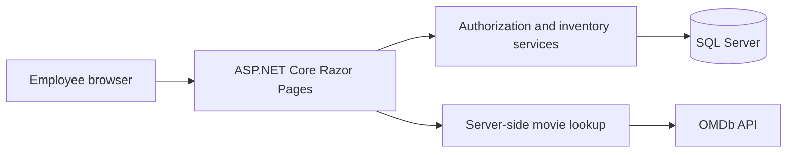
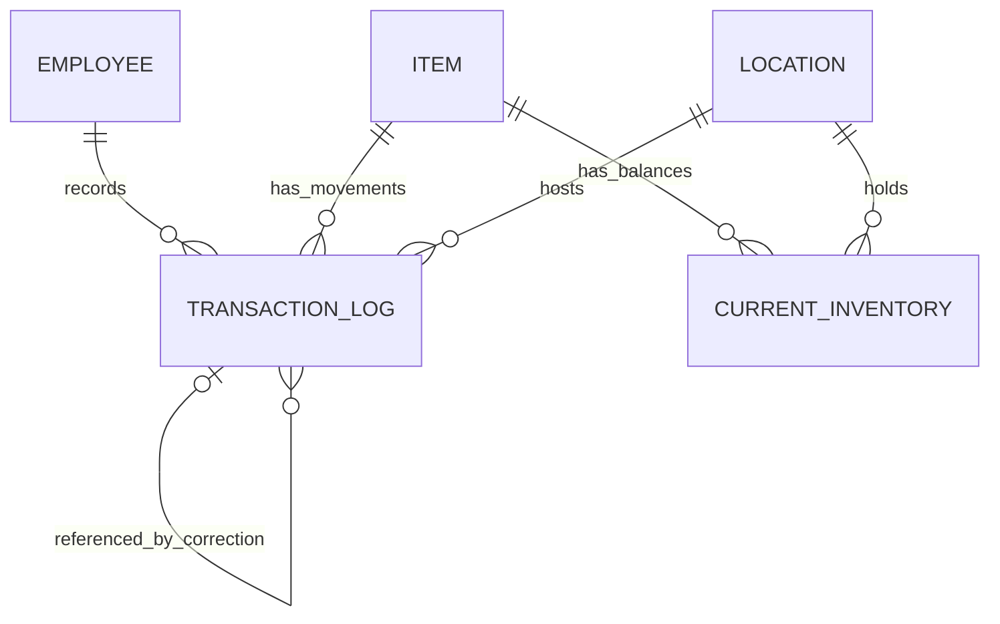

# Architecture and database design

**Status:** proposed implementation design. The supplied SQL script was reviewed as text; actual database connectivity, deployed tables, and application behavior have not been verified.

## Application structure

Use one ASP.NET Core Razor Pages application. Keep page handling, business rules, and database operations separated enough to test inventory behavior, without introducing microservices or a separate frontend application.

The browser never needs the SQL Server connection string or OMDb key. The database must remain usable when OMDb is unavailable because movie metadata is optional.

The exact .NET version, data access library, authentication configuration, and deployment target will be selected during implementation. If the chosen authentication framework needs additional tables or a larger password-hash field, reconcile that explicitly with the five core business entities rather than assuming compatibility.

## Core entities

| Entity | Key | Responsibility |
| --- | --- | --- |
| EMPLOYEE | employee_id | Identity, username, password hash, role, employment status |
| ITEM | item_id | Movie/game catalog entry and physical format |
| LOCATION | location_id | Warehouse name, address, and status |
| CURRENT_INVENTORY | (item_id, location_id) | Quantity on hand and last-updated timestamp |
| TRANSACTION_LOG | transaction_id | Employee-attributed stock movement and optional correction reference |

The self-reference above is a proposed addition, not present in the supplied creation script. Its cardinality shows what a simple optional foreign key permits; the final application policy for repeated corrections is still to be settled.

Current Inventory resolves the item/location relationship. It has no direct foreign key to Employee or Transaction Log. A movement's item and location identify the balance it affects.

## Baseline SQL review

The supplied creation script already defines:

- The five core tables with generated identifiers where applicable.
- A composite primary key on Current Inventory.
- Unique employee usernames.
- Positive movement quantities and nonnegative inventory balances.
- Movie/game and check-in/check-out value constraints.
- Foreign keys with `ON DELETE NO ACTION`.
- UTC timestamp defaults using `SYSUTCDATETIME()`.

The script requires a real expected database name and refuses to create tables when any of the five target names already exists. It is a fresh-schema installer, not an incremental update script. Inspect existing tables and prepare targeted changes later; do not drop/recreate populated tables to apply these plans.

## Planned schema adjustments

Field names below are proposals; changes have not been applied.

| Table | Proposed change | Reason |
| --- | --- | --- |
| ITEM | Nullable `poster_url` | OMDb movie poster or manually entered game poster |
| ITEM | Nullable `age_rating` | Age classification, such as PG-13 or T; not a review score |
| ITEM | Required `item_status` constrained to ACTIVE/ARCHIVED | Retire catalog records without removing history |
| TRANSACTION_LOG | Nullable `corrects_transaction_id`, referencing TRANSACTION_LOG | Link manager corrections to their original movement |
| EMPLOYEE | Constrain `access_role` to STAFF/MANAGER | Prevent invalid roles |
| EMPLOYEE | Constrain employment status to ACTIVE/INACTIVE/TERMINATED | Match the agreed access rules |
| LOCATION | Constrain status to ACTIVE/INACTIVE | Match warehouse availability rules |
| ITEM | Reject blank `media_format` | Enforce the required catalog field |

Choose suitable field lengths during implementation. Store movie metadata on the selected catalog item; do not require an external API call every time the catalog is opened. Consider a provider identifier if needed to retain the selected OMDb match, but it is not an agreed required field yet.

## Inventory consistency

Every movement must perform these steps as one database transaction:

1. Check the employee's current access and the item/location's active status.
2. Validate direction and positive whole-number quantity.
3. Safely find or create the item/location balance and apply the movement against current stock.
4. Insert the matching movement entry with server-derived employee/time and correction details if applicable.
5. Refresh `last_updated_at` and commit, or roll back all changes.

Use SQL Server concurrency controls or a conditional update pattern appropriate to the selected data access library. An earlier browser preview is not sufficient protection against competing check-outs. Handle simultaneous first check-ins to the same item/location without duplicate balances.

The nonnegative quantity constraint is a useful final guard, but does not by itself ensure balance/history consistency. Timestamp defaults initialize rows; they do not automatically update `last_updated_at` after later movements.

## History and retirement

- No application workflow directly edits stock balances or edits/deletes log entries.
- Foreign keys prevent deleting referenced parents; they do not prevent direct deletion of the log itself. Application/database access must respect history retention.
- Corrections retain both entries and reference the same item/location with the opposite direction and a required explanation.
- Archive an item only when all its warehouse balances are zero. Deactivate a warehouse only when all its balances are zero.
- Manager authorization and zero-stock checks must be enforced when saving, not just when showing a button.

## Configuration

Configure SQL Server connectivity and the OMDb key securely outside source control using the configuration mechanism selected for the application. No credentials, connection string, or API key is included in these documents. Database access and OMDb access remain unverified until implementation setup.
